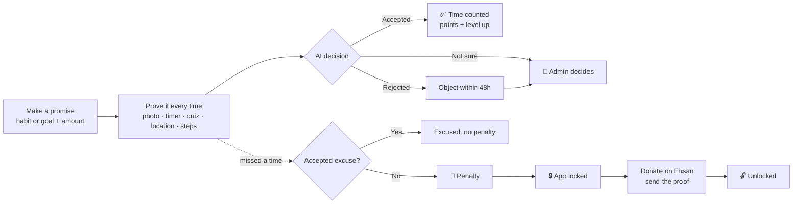
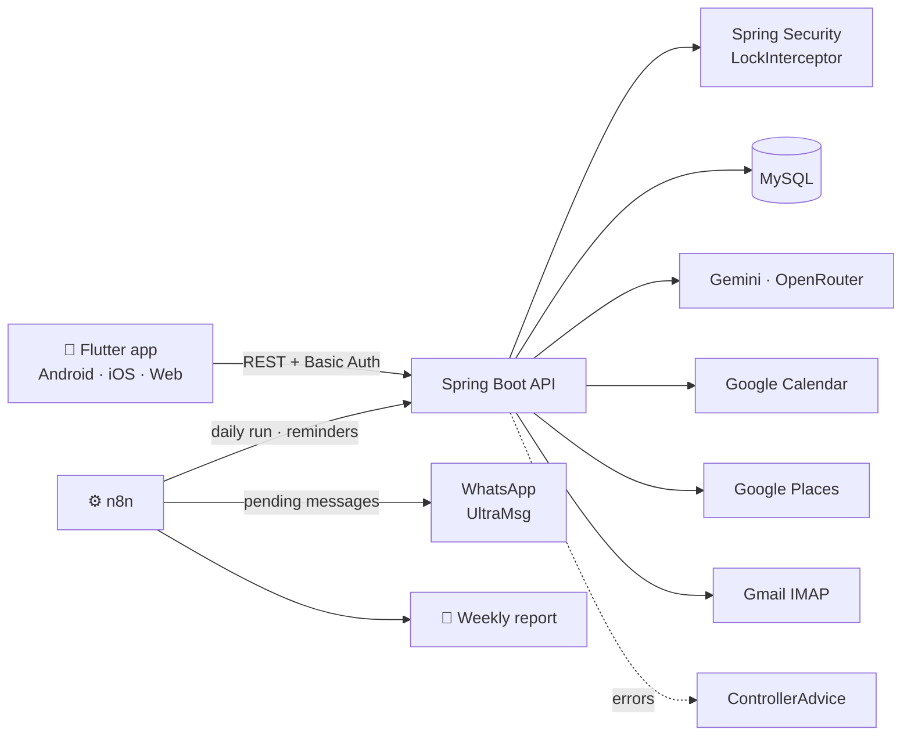
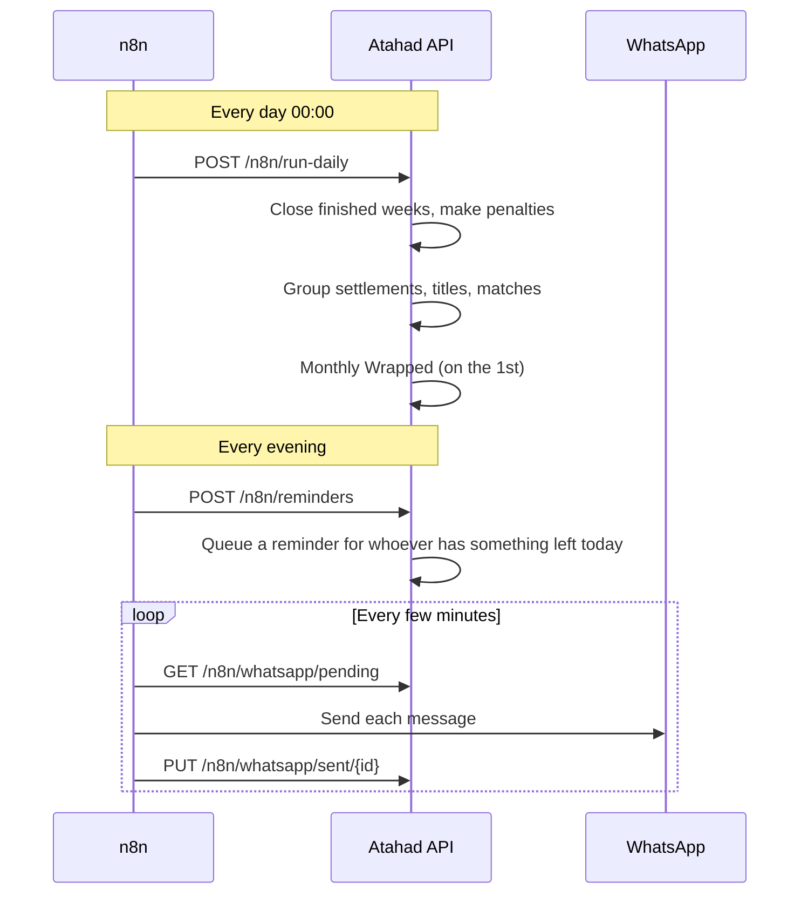
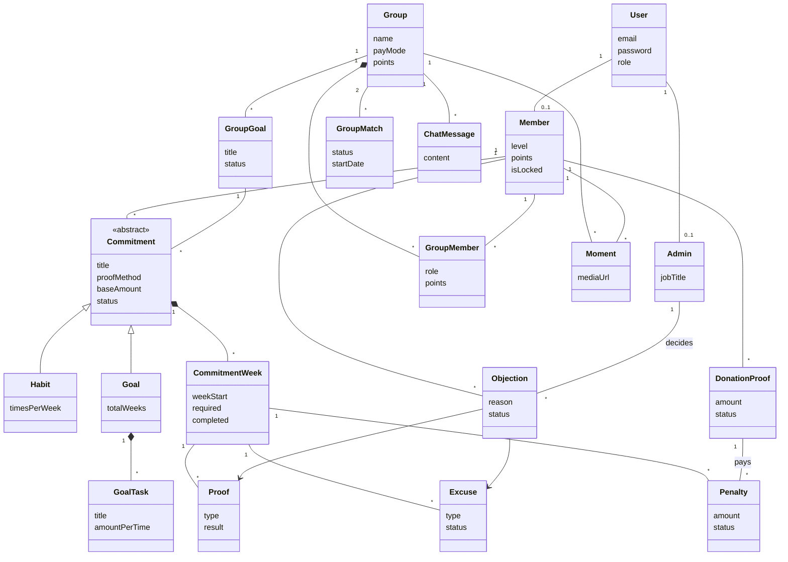

<div align="center">

<picture>
  <source media="(prefers-color-scheme: dark)" srcset="frontend/assets/brand/logo_reverse.png">
  
</picture>

# Atahad · أتعهّد

**Keep your promise, or a charity wins. Either way, good is done.**

### في الحالتين.. خير

تطبيق يساعدك تلتزم بعاداتك وأهدافك: إمّا تنجز، أو يروح مبلغ التعهّد صدقة

<br>


<br>


<br>

**193 endpoints (52 CRUD + 141 extra) · 43 controllers · 4 team members · 5 ways to prove you did it**

</div>

---

> You promise to go to the gym 3 times a week, read 20 pages a day, or finish a course in 8 weeks, and you put money on it.
> Every week you **prove** it with a photo, a timer, a quiz, your location or your steps, and an AI checks the proof.
> Miss a time without a real excuse and the amount goes as a **donation to [Ehsan](https://ehsan.sa)**, the national charity platform.
> Until you donate, the app stays **locked**. Do it with friends in a **group** and the whole team carries the result.
>
> **أتعهّد** turns "I'll start on Monday" into a promise with a price, and the price is always a good deed.

## 📑 Table of Contents

- [How It Works](#-how-it-works)
- [Features](#-features)
- [Five Ways to Prove It](#-five-ways-to-prove-it)
- [AI Inside Atahad](#-ai-inside-atahad)
- [Integrations](#-integrations)
- [Architecture](#️-architecture)
- [The Weekly Cycle](#-the-weekly-cycle)
- [Data Model](#️-data-model)
- [Project Structure](#-project-structure)
- [Getting Started](#-getting-started)
- [API Overview](#-api-overview)
- [Team](#-team)
- [Endpoints by Member](#-endpoints-by-member)

## 🔁 How It Works



## ✨ Features

### 🎯 Commitments
- **Habits**: something you do X times a week (gym, reading, prayer at the mosque) with an amount per time.
- **Goals**: something with an end date (finish a book, a course, a program). The **AI suggests a weekly plan** from the goal and its deadline; the member accepts or changes it before it starts.
- **Weekly tasks** for goals, with the option to copy a task to every week that has not started yet.
- **Today screen**: what is left this week and what must be done today.
- **Postpone inside the week**: move today's time to another day of the same week, and the reminders move with it.
- **Withdraw**: the member finishes the current week and the commitment ends after it; the withdrawal can be cancelled before the week ends.
- **Start date**: week 1 can start today or on a later day.

### 🧾 Proofs, excuses & objections
- **Five proof methods** (see below), and the admin can turn each method on or off for the whole app.
- **AI decides every proof and excuse**: `ACCEPTED`, `REJECTED`, or `ESCALATED` to an admin when it is not sure.
- **Excuses**: one excused time per accepted excuse. A time that was already paid gives a **compensation grace day**.
- **Objections**: a rejected proof or excuse can be objected to within 48 hours, and an admin decides.
- **Admin review queue**: everything the AI was not sure about, in one place, with the evidence.

### 💸 Penalties, donations & the lock
- A missed time, a withdrawal, or a failed group week creates a **penalty**.
- An unpaid penalty **locks the app**. A locked member can only donate, send an excuse, or object.
- **Two ways to prove a donation**: screenshots of the bank SMS + the Ehsan SMS, or **automatically from Gmail**: the app reads the bank email with IMAP (read only, App Password).
- Three refusals to pay a group donation = **banned** until paid.
- The lock is never set by hand; it is calculated from the data every time.

### 👥 Groups
- Create a group, invite friends with an **invite code / QR**, or add them by phone number.
- **Group goals**: the AI suggests 3 goals, members propose and **vote**, and the owner confirms the plan.
- **Pay mode** chosen at creation: `SOLO` (only the one who missed donates) or `ALL` (everyone donates).
- **Weekly settlement** every Sunday 00:00: a golden week gives points to everyone; a failure means donations, and a second failure removes the member.
- **Weekly titles**: 🦾 Iron, 🚀 Rocket, 🦉 Owl, 🚨 Alarmist, 🔄 Comeback, 👑 Excuse King, 💎 Top Donor.
- **Group board**: every member and what is left for them this week.
- **The siren**: send an alert to a friend who has not finished today.
- **Group matches**: challenge a similar group (the app suggests opponents) or any group by invite code.
- **Chat** and **Moments**: a photo/video feed from the camera, plus a home screen widget.

### 🏆 Motivation
- **Points and levels**, and a **grace day** for every 150 points (or when the group reaches 300 points).
- **Monthly Wrapped**: a Spotify-Wrapped-style card each month; the numbers come from the database and the AI writes the text.
- **Activity map**: a year heatmap of the member's proofs.
- **Lucky Challenge**: a random AI challenge by difficulty (easy, medium, hard).
- **Learn Quest**: search books (Open Library), podcasts and courses (Edraak) to turn into a learning goal.
- **Google Calendar**: the AI reads the member's free time and suggests a schedule; the member approves it and it is added to the calendar.
- **WhatsApp reminders** every evening for anyone who still has something to do today, and a **weekly AI email report**.

## 📸 Five Ways to Prove It

| Method | How it works | Checked by |
|---|---|---|
| 📷 **PHOTO** | A live camera photo with a **random challenge** (e.g. "show 3 fingers") created when the camera opens, so old photos cannot be reused. Optional before/after photos. | AI vision |
| ⏱️ **TIMER** | A focus session that must reach the required minutes. The app keeps the timer on the server, so closing the app does not cheat it, and the AI writes motivating messages along the way. | Server timer + AI |
| 🧠 **QUIZ** | The AI generates questions about what the member studied today (from the topic or photos of the pages). | AI quiz |
| 📍 **LOCATION** | The member picks the place on the map (Google Places), then enters and exits; the proof is made when the visit inside the radius is long enough. | GPS + geofence |
| 🚶 **STEPS** | Daily steps synced from Health Connect / Apple Health, or a screenshot of the steps app as a fallback. | Health data or AI vision |

## 🧠 AI Inside Atahad

| Where | What the AI does |
|---|---|
| 📷 **Proof review** | Looks at the photo and the challenge and decides `ACCEPTED`, `REJECTED` or `ESCALATED`, with a reason in Arabic. |
| 📝 **Excuse review** | Reads the excuse and its attachments and decides if it is acceptable. |
| 🧾 **Donation review** | Reads the bank SMS / Ehsan SMS screenshots or the bank email and matches the amount to what is owed. |
| 🧠 **Quiz** | Generates questions about the topic studied today, with logical options. |
| ⏱️ **Timer messages** | Short motivating messages during a focus session. |
| 🗓️ **Goal plans** | Spreads a goal over its weeks: how many times each week, from the goal and its end date. |
| 👥 **Group goals** | Suggests 3 goals for a group, and writes the weekly settlement in a fun way (the facts come from the code). |
| 🎲 **Lucky Challenge** | A random challenge by difficulty. |
| 📅 **Calendar schedule** | Analyses the member's free days and suggests when to do each commitment. |
| 🎁 **Monthly Wrapped** | Writes the monthly summary text from real numbers. |

The AI runs on **Google Gemini** (OpenAI-compatible API) and **OpenRouter** (Gemma 4 for text, vision and timer), each with a list of **fallback models**. If every model fails, or there is no key, a rule-based fallback takes over or the case is escalated to an admin, so the app never gets stuck.

## 🔌 Integrations

| Service | Used for | How |
|---|---|---|
|  **Google Gemini** | Decisions, plans, group texts, wrapped | `AiService` talks to Gemini through its OpenAI-compatible endpoint, with a fallback for every call. |
| 🔀 **OpenRouter** | Proof images, quizzes, timer messages | `OpenRouterClient` sends text and vision requests and tries the next model on failure. |
|  **Google Calendar (OAuth 2)** | AI schedule in the member's calendar | `GoogleCalendarService` connects with OAuth, stores the tokens **encrypted** (`GoogleTokenCryptoService`), and adds the approved events. |
|  **Google Places API** | Choosing the place of a LOCATION commitment | `PlaceSearchService` searches by name and puts the nearest places first. |
|  **Gmail IMAP** | Donation proof from the bank email | `GmailService` reads the bank emails read-only with a Google App Password. |
|  **n8n** | Scheduling and messaging | Two workflows in [`n8n/`](n8n): the daily run + WhatsApp queue, and the weekly AI email report. |
|  **UltraMsg (WhatsApp)** | Reminders and alerts | The backend queues `WhatsAppMessage` rows; n8n sends them and marks each one sent or failed. |
| 📚 **Open Library · Edraak** | Learn Quest | Books with covers from Open Library, courses from Edraak; one provider failing does not stop the others. |
| ❤️ **Health Connect / Apple Health** | STEPS proofs | The Flutter `health` package reads the daily steps and syncs them to the backend. |

## 🏗️ Architecture



Every request from a member passes through the **`LockInterceptor`**, which checks whether the member is `ACTIVE`, `LOCKED`, `BANNED` or `DEACTIVATED` and allows only what that state allows.

## 📆 The Weekly Cycle

A week runs **Sunday → Saturday**. Proofs and excuses count until Saturday 23:59:59.



## 🗄️ Data Model

The 19 core classes (out of 37 entities):



<details>
<summary><b>The other 18 entities</b></summary>

| Entity | Description |
|---|---|
| `GraceDay` | A pardon card: earned with points, given by an admin, or as compensation; valid for 4 weeks |
| `GroupSettlement` | The weekly result of a group, with the titles of that week |
| `PointLog` | Group points history |
| `MonthlyWrapped` | The monthly summary card |
| `ProofChallenge` | The random challenge shown when the camera opens |
| `ProofCapture` · `ProofEvidence` | Uploaded photos/files and the evidence the AI and admins review |
| `ProofMethodOption` | The five proof methods and whether each is enabled |
| `TimerSession` | The server-side state of a TIMER proof |
| `Quiz` | A generated quiz for a QUIZ proof |
| `PlaceVisit` | One enter/exit visit for a LOCATION proof |
| `DailySteps` · `StepConnection` | Synced steps per day and the health connection status |
| `LuckyChallenge` | A random AI challenge |
| `GoogleCalendarConnection` · `GoogleCalendarOAuthState` | Encrypted Google tokens and the OAuth state |
| `WhatsAppMessage` | The outgoing WhatsApp queue read by n8n |

</details>

## 📁 Project Structure

```
Atahad
├── src/main/java/com/example/atahad
│   ├── AI           # AiService (Gemini), OpenRouterClient, proof image / quiz / timer AI
│   ├── Advice       # ControllerAdvice: one error format for the whole API
│   ├── Api          # ApiException, ApiResponse
│   ├── Config       # SecurityConfig, LockInterceptor, CORS, dev data seeders
│   ├── Controller   # 43 REST controllers
│   ├── Dto          # In (requests with validation) and Out (responses)
│   ├── Entity       # 37 JPA entities
│   ├── Repository   # Spring Data JPA repositories
│   └── Service      # Business logic, schedulers, integrations
├── frontend         # Flutter app
│   └── lib
│       ├── core         # API client, theme, router, shared widgets
│       └── features     # account · commitments · proofs · groups · walking · learn_quest · lucky_challenge
├── n8n              # Daily automation + WhatsApp, weekly AI email report
└── docs             # Design decisions, proof methods, design system
```

## 🚀 Getting Started

**Requirements:** Java 17, MySQL (or MariaDB / XAMPP), Flutter 3 with Dart 3.8+.

### Backend

```bash
git clone https://github.com/FaiAlharthi/Atahad.git
cd Atahad
./mvnw clean spring-boot:run
```

The API runs on `http://localhost:8080` and uses the database `Atahad_db` (root, no password by default). Tables are created by Hibernate.

Keys are read from environment variables, or from an optional `src/main/resources/application-local.properties` (not committed). Every one is optional: without a key, that feature falls back or turns off.

| Variable | Used for |
|---|---|
| `AI_API_KEY` | Google Gemini |
| `OPENROUTER_API_KEY`, `OPENROUTER_TEXT_MODEL`, `OPENROUTER_VISION_MODEL`, `OPENROUTER_TIMER_MODEL` | OpenRouter models |
| `OPENROUTER_TEXT_FALLBACKS`, `OPENROUTER_VISION_FALLBACKS`, `OPENROUTER_TIMER_FALLBACKS` | Fallback models, comma separated |
| `GOOGLE_CLIENT_ID`, `GOOGLE_CLIENT_SECRET`, `GOOGLE_CALENDAR_ENCRYPTION_KEY` | Google Calendar (the key is 32 bytes, base64) |
| `GOOGLE_PLACES_API_KEY` | Place search |
| `ULTRAMSG_API_URL`, `ULTRAMSG_INSTANCE_ID`, `ULTRAMSG_TOKEN` | WhatsApp |
| `N8N_KEY` | Protects the `/n8n` endpoints |

Set `seed.enabled=true` in `application-local.properties` to fill the database with demo members, groups and commitments.

### Frontend

```bash
cd frontend
flutter pub get
flutter run -d chrome --web-port 5173     # web (the backend CORS allows localhost:5173)
flutter run                               # Android / iOS
```

On an Android emulator, run `adb reverse tcp:8080 tcp:8080` so the app can reach the local backend.

### n8n

Import the two workflows from [`n8n/`](n8n) and set the backend URL and `N8N_KEY` in them.

## 📊 API Overview

All endpoints start with `/api/v1` and use HTTP Basic authentication, except registration and the public callbacks (Google OAuth, n8n with its own key).

**193 endpoints across 43 controllers: 52 CRUD + 141 extra.**

| Part | Owner | Controllers | Total | CRUD | Extra |
|---|---|---|---|---|---|
| 1 · Core & Users | Abdulelah Alwadani | User, Member, Admin, Account, N8n, ActivityMap, GoogleCalendar, LearnQuest, LuckyChallenge | **45** | 13 | **32** |
| 2 · Proofs, Excuses & Donations | Subhiyyah Alkhedher | Proof, ProofAttempt, ProofWorkspace, ProofAttachment, ProofChallenge, ProofMethod, Quiz, HabitCheckIn, PlaceVisit, Place, WalkingSteps, Excuse, Objection, AdminReview, Penalty, DonationProof | **57** | 16 | **41** |
| 3 · Commitments | Turki Alghamdi | Commitment, CommitmentWeek, Habit, Goal, GoalTask, GraceDay, PointLog, MonthlyWrapped | **45** | 15 | **30** |
| 4 · Groups | Fai Alharthi | Group, GroupMember, GroupGoal, GoalProposal, GroupMatch, GroupSettlement, GroupTitle, GroupAlert, ChatMessage, Moment | **46** | 8 | **38** |
| | | **Total** | **193** | **52** | **141** |

CRUD = the basic get all, get by id, add, update and delete of a resource. Extra = everything else: filtered lists, actions (vote, withdraw, join ...), AI, and automation.

## 👥 Team

<table>
  <tr>
    <td align="center" width="25%" valign="top">
      <a href="https://github.com/Abdulelah12345"><br><b>Abdulelah Alwadani</b></a><br>
      <sub>Backend & Frontend</sub><br><sub>&nbsp;</sub><br><br>
      <b>Part 1</b><br><sub>Core & Users</sub><br><br>
      <b>45</b> endpoints<br>
      <sub>13 CRUD · 32 extra</sub><br><br>
      <sub>Security, users, members, admins, account lock, n8n automation, Google Calendar, Learn Quest, Lucky Challenge</sub>
    </td>
    <td align="center" width="25%" valign="top">
      <a href="https://github.com/subhiyyah"><br><b>Subhiyyah Alkhedher</b></a><br>
      <sub>Backend & Frontend</sub><br><sub>&nbsp;</sub><br><br>
      <b>Part 2</b><br><sub>Proofs & Donations</sub><br><br>
      <b>57</b> endpoints<br>
      <sub>16 CRUD · 41 extra</sub><br><br>
      <sub>The five proof methods, AI review, excuses, objections, admin review, penalties, donation proofs</sub>
    </td>
    <td align="center" width="25%" valign="top">
      <a href="https://github.com/gTurki"><br><b>Turki Alghamdi</b></a><br>
      <sub>Backend & Frontend</sub><br><sub>&nbsp;</sub><br><br>
      <b>Part 3</b><br><sub>Commitments</sub><br><br>
      <b>45</b> endpoints<br>
      <sub>15 CRUD · 30 extra</sub><br><br>
      <sub>Habits, goals and AI plans, weekly cycle, today screen, grace days, points, monthly wrapped</sub>
    </td>
    <td align="center" width="25%" valign="top">
      <a href="https://github.com/FaiAlharthi"><br><b>Fai Alharthi</b></a><br>
      <sub>👑 Team Leader</sub><br><sub>Backend & Frontend</sub><br><br>
      <b>Part 4</b><br><sub>Groups</sub><br><br>
      <b>46</b> endpoints<br>
      <sub>8 CRUD · 38 extra</sub><br><br>
      <sub>Groups, invites, group goals and voting, weekly settlement and titles, matches, chat, moments, alerts</sub>
    </td>
  </tr>
</table>

## 🧩 Endpoints by Member

Paths are relative to `/api/v1`. 🤖 = uses AI.

<details>
<summary> &nbsp;<b>Abdulelah Alwadani</b> · Part 1 · Core & Users (45)</summary>

| Method | Endpoint | Description |
|---|---|---|
| `GET` | `/user/get` | All users |
| `GET` | `/user/get/{id}` | A user by id |
| `PUT` | `/user/update` | Update my user |
| `DELETE` | `/user/delete` | Delete my user |
| `GET` | `/member/get` | All members |
| `GET` | `/member/get/{id}` | A member by id |
| `GET` | `/member/profile` | My profile |
| `POST` | `/member/register` | Register as a member |
| `PUT` | `/member/update` | Update my profile |
| `DELETE` | `/member/delete` | Delete my account |
| `GET` | `/member/activity-map` | Year heatmap of my proofs |
| `GET` | `/admin/get` | All admins |
| `GET` | `/admin/get/{id}` | An admin by id |
| `GET` | `/admin/profile` | My admin profile |
| `POST` | `/admin/register` | Register an admin |
| `PUT` | `/admin/update` | Update my admin profile |
| `GET` | `/admin/members` | Search members |
| `PUT` | `/admin/members/{memberId}/suspend` | Suspend a member |
| `PUT` | `/admin/members/{memberId}/restore` | Restore a member |
| `POST` | `/admin/members/{memberId}/grace-day` | Gift a grace day |
| `GET` | `/admin/proof-methods` | All proof methods |
| `PUT` | `/admin/proof-methods/{id}/toggle` | Turn a proof method on or off |
| `PUT` | `/account/deactivate` | Deactivate my account |
| `PUT` | `/account/unban/{adminId}/{memberId}` | Unban a member (admin) |
| `POST` | `/n8n/run-daily` | Daily job: weeks, settlements, matches, wrapped |
| `POST` | `/n8n/reminders` | Evening reminders |
| `GET` | `/n8n/whatsapp/pending` | WhatsApp messages waiting to be sent |
| `PUT` | `/n8n/whatsapp/sent/{id}` | Mark a message as sent |
| `PUT` | `/n8n/whatsapp/failed/{id}` | Mark a message as failed |
| `GET` | `/n8n/weekly-reports` | Data for the weekly AI email report |
| `GET` | `/google-calendar/connect` | Start Google OAuth |
| `GET` | `/google-calendar/callback` | Google OAuth callback |
| `GET` | `/google-calendar/status` | Connection status |
| `DELETE` | `/google-calendar/disconnect` | Disconnect Google Calendar |
| `POST` | `/google-calendar/generate` | 🤖 Generate a schedule from my free time |
| `POST` | `/google-calendar/approve-schedule` | Approve and add the events to my calendar |
| `POST` | `/google-calendar/reject-schedule` | Reject the suggested schedule |
| `GET` | `/learn-quest/search` | Search books, podcasts and courses |
| `GET` | `/learn-quest/books` | Books (Open Library) |
| `GET` | `/learn-quest/podcasts` | Podcasts |
| `GET` | `/learn-quest/courses` | Courses (Edraak) |
| `POST` | `/lucky-challenge/random/{difficulty}` | 🤖 A random challenge |
| `POST` | `/lucky-challenge/accept/{challengeId}` | Accept the challenge |
| `POST` | `/lucky-challenge/proof/{challengeId}` | Prove the challenge |
| `GET` | `/lucky-challenge/my` | My current challenge |

</details>

<details>
<summary> &nbsp;<b>Subhiyyah Alkhedher</b> · Part 2 · Proofs, Excuses & Donations (57)</summary>

| Method | Endpoint | Description |
|---|---|---|
| `GET` | `/proof/get-all` | All proofs (admin) |
| `GET` | `/proof/get/{id}` | A proof by id |
| `POST` | `/proof/add/goal-task/{goalTaskId}/week/{commitmentWeekId}` | 🤖 Prove a goal task |
| `PUT` | `/proof/update/goal-task/{proofId}` | Update a goal task proof |
| `DELETE` | `/proof/delete/goal-task/{proofId}` | Delete a goal task proof |
| `GET` | `/proof/get-my-proofs` | My proofs |
| `POST` | `/proof/habit/{memberId}/{weekId}` | 🤖 Prove a habit, with the AI decision right away |
| `POST` | `/excuse/habit/{memberId}/{weekId}` | 🤖 Excuse for a habit (works while locked) |
| `GET` | `/proof-attempt/suggest/{weekId}` | Suggested proof method for this week |
| `POST` | `/proof-attempt/start/{weekId}` | Start a proof attempt |
| `GET` | `/proof-attempt/{proofId}` | State of an attempt |
| `POST` | `/proof-attempt/{proofId}/submit` | 🤖 Submit the attempt |
| `POST` | `/proof-attempt/{proofId}/after` | Send the "after" photo |
| `POST` | `/proof-attempt/{proofId}/skip-photos` | Continue without before/after photos |
| `POST` | `/proof-attempt/capture` | Create a capture |
| `POST` | `/proof-attempt/capture/{id}` | Upload the capture file |
| `POST` | `/proof-attempt/timer/{id}/{action}` | 🤖 Start, pause, resume or finish a timer |
| `GET` | `/proof-workspace/my` | My proofs, excuses and objections in one place |
| `GET` | `/proof-workspace/attachment/{captureId}` | An attachment file |
| `POST` | `/excuse/attachment` | Create an excuse/donation attachment |
| `POST` | `/excuse/attachment/{captureId}` | Upload the attachment file |
| `POST` | `/challenge/create/{memberId}/{weekId}` | Random challenge when the camera opens |
| `POST` | `/quiz/create/{memberId}/{weekId}` | 🤖 Generate a quiz |
| `GET` | `/proof-method/active` | Proof methods a member can pick now |
| `GET` | `/place/search` | Search a place by name, nearest first |
| `POST` | `/visit/enter/{memberId}/{commitmentId}` | Enter the place |
| `POST` | `/visit/exit/{memberId}/{commitmentId}` | Exit the place and make the proof |
| `GET` | `/visit/my/{memberId}` | My visits |
| `GET` | `/walking/connection` | Health connection status |
| `PUT` | `/walking/connection` | Update the health connection |
| `POST` | `/walking/weeks/{weekId}/sync` | Sync daily steps |
| `POST` | `/walking/weeks/{weekId}/screenshot` | 🤖 Steps screenshot as a fallback |
| `GET` | `/walking/weeks/{weekId}/progress` | Steps progress of a day |
| `GET` | `/excuse/get` | All excuses |
| `GET` | `/excuse/get/{id}` | An excuse by id |
| `POST` | `/excuse/add/goal-task/{goalTaskId}/week/{commitmentWeekId}` | 🤖 Excuse for a goal task |
| `PUT` | `/excuse/update/goal-task/{excuseId}` | Update an excuse |
| `DELETE` | `/excuse/delete/goal-task/{excuseId}` | Delete an excuse |
| `GET` | `/objection/get-all` | All objections (admin) |
| `GET` | `/objection/get/{id}` | An objection by id |
| `POST` | `/objection/add/proof/{proofId}` | Object to a rejected proof |
| `POST` | `/objection/add/excuse/{excuseId}` | Object to a rejected excuse |
| `PUT` | `/objection/update/{objectionId}` | Update an objection |
| `DELETE` | `/objection/delete/{objectionId}` | Delete an objection |
| `GET` | `/admin-review/queue/{adminId}` | Everything the AI was not sure about |
| `POST` | `/admin-review/start/{adminId}/{objectionId}` | Start reviewing an objection |
| `PUT` | `/admin-review/decide/{adminId}/{kind}/{id}/{accept}` | Decide a proof, excuse, objection or donation |
| `GET` | `/admin-review/penalties/{adminId}` | Penalties workspace |
| `GET` | `/penalty/my/{memberId}` | My penalties |
| `GET` | `/penalty/get/{adminId}` | All penalties (admin) |
| `PUT` | `/penalty/cancel/{adminId}/{penaltyId}` | Cancel a penalty made by mistake (admin) |
| `POST` | `/donation-proof/screenshot/{memberId}` | 🤖 Donation proof from the bank + Ehsan SMS screenshots |
| `POST` | `/donation-proof/email/{memberId}` | 🤖 Donation proof from the bank email in Gmail |
| `POST` | `/donation-proof/gmail/connect/{memberId}` | Link Gmail with an App Password |
| `DELETE` | `/donation-proof/gmail/disconnect/{memberId}` | Unlink Gmail |
| `GET` | `/donation-proof/my/{memberId}` | My donation proofs |
| `POST` | `/donation-proof/objection/{memberId}/{donationProofId}` | Object to a rejected donation (48 hours) |

</details>

<details>
<summary> &nbsp;<b>Turki Alghamdi</b> · Part 3 · Commitments (45)</summary>

| Method | Endpoint | Description |
|---|---|---|
| `GET` | `/commitment/getMyCommitments` | My habits and goals |
| `GET` | `/commitment/get/{id}` | A commitment by id |
| `PUT` | `/commitment/withdraw/{id}` | Withdraw at the end of this week |
| `PUT` | `/commitment/withdraw/cancel/{id}` | Cancel the withdrawal |
| `PUT` | `/commitment/target/{id}` | Set the place (LOCATION) or the minutes (TIMER) |
| `GET` | `/commitment/lockStatus` | Lock state for the lock screen |
| `GET` | `/commitment/stats` | Level, points, grace days and total donated |
| `GET` | `/commitment/learning-goal` | Whether the member has a learning goal |
| `GET` | `/commitment-week/get/{id}` | A week by id |
| `GET` | `/commitment-week/getHistory/{commitmentId}` | All weeks of a commitment |
| `GET` | `/commitment-week/getCurrent/{commitmentId}` | The current week |
| `GET` | `/commitment-week/today` | Today screen: what is left this week and today |
| `PUT` | `/commitment-week/changePlan/{weekId}` | Postpone a time inside this week |
| `POST` | `/commitment-week/runDaily` | Run the daily job (for testing a date) |
| `GET` | `/habit/get` | All habits (admin) |
| `GET` | `/habit/getMyHabits` | My habits |
| `POST` | `/habit/add` | Add a habit |
| `PUT` | `/habit/update/{id}` | Update a habit (from next week) |
| `DELETE` | `/habit/delete/{id}` | Delete a habit |
| `GET` | `/goal/get` | All goals (admin) |
| `GET` | `/goal/getMyGoals` | My goals |
| `POST` | `/goal/add` | Add a goal |
| `POST` | `/goal/suggest` | 🤖 Suggest the times of every week |
| `POST` | `/goal/addWithPlan` | Save the goal with its weekly plan and start it |
| `PUT` | `/goal/start/{id}` | Start a goal |
| `GET` | `/goal/progress/{id}` | Goal progress |
| `PUT` | `/goal/update/{id}` | Update a goal |
| `DELETE` | `/goal/delete/{id}` | Delete a goal |
| `GET` | `/goal-task/getByGoal/{goalId}` | Tasks of a goal |
| `GET` | `/goal-task/getByWeek/{goalId}/{weekNumber}` | Tasks of one week |
| `POST` | `/goal-task/add/{goalId}` | Add a task |
| `POST` | `/goal-task/addToAllWeeks/{goalId}` | Copy a task to every week that did not start |
| `PUT` | `/goal-task/update/{id}` | Update a task |
| `DELETE` | `/goal-task/delete/{id}` | Delete a task |
| `GET` | `/grace-day/get` | All grace days (admin) |
| `GET` | `/grace-day/get/{id}` | A grace day by id (admin) |
| `GET` | `/grace-day/member/{memberId}` | Grace days of a member (admin) |
| `GET` | `/grace-day/my` | My grace days |
| `POST` | `/grace-day/grant/{memberId}` | Grant a grace day (admin) |
| `POST` | `/grace-day/earn` | Exchange 150 points for a grace day |
| `PUT` | `/grace-day/use/{graceDayId}/{weekId}` | Use a grace day on a week |
| `GET` | `/point-log/my` | My points history |
| `GET` | `/point-log/group/{groupId}` | Group points history |
| `GET` | `/monthly-wrapped/my` | My monthly wrapped cards |
| `POST` | `/monthly-wrapped/generate/{month}` | 🤖 Generate the wrapped of a month |

</details>

<details>
<summary> &nbsp;<b>Fai Alharthi</b> · Part 4 · Groups (46)</summary>

| Method | Endpoint | Description |
|---|---|---|
| `GET` | `/group/get` | All groups (admin) |
| `GET` | `/group/get/{id}` | A group by id |
| `POST` | `/group/add` | Create a group |
| `PUT` | `/group/update/{groupId}` | Update a group |
| `GET` | `/group/invite/{groupId}` | The invite code and QR content |
| `PUT` | `/group/resetInvite/{groupId}` | Make a new invite code |
| `DELETE` | `/group/delete/{groupId}` | Archive a group (history stays) |
| `GET` | `/group-member/group/{groupId}` | Members of a group |
| `GET` | `/group-member/my` | My groups |
| `GET` | `/group-member/member/{memberId}` | Groups of any member (admin) |
| `POST` | `/group-member/join/{inviteCode}` | Join with an invite code or QR |
| `POST` | `/group-member/add/{groupId}/{memberId}` | Owner adds a member directly |
| `POST` | `/group-member/addByPhone/{groupId}` | Owner adds a friend by phone number |
| `DELETE` | `/group-member/leave/{groupId}` | Leave a group |
| `POST` | `/group-goal/suggest/{groupId}` | 🤖 Suggest a weekly plan for the group goal |
| `POST` | `/group-goal/add/{groupId}` | Owner confirms the group goal |
| `GET` | `/group-goal/active/{groupId}` | The active group goal |
| `GET` | `/group-goal/history/{groupId}` | Past group goals |
| `GET` | `/group-goal/board/{groupId}` | Group board: every member and what is left this week |
| `GET` | `/group-goal/my-task/{groupId}` | My task of the goal this week |
| `GET` | `/group-goal/my-place/{groupId}` | My place for a LOCATION goal |
| `PUT` | `/group-goal/my-place/{groupId}` | Set my place for a LOCATION goal |
| `POST` | `/goal-proposal/ai/{groupId}` | 🤖 AI suggests 3 goals |
| `POST` | `/goal-proposal/add/{groupId}` | Propose a goal |
| `GET` | `/goal-proposal/open/{groupId}` | Open proposals, most voted first |
| `PUT` | `/goal-proposal/vote/{proposalId}` | Vote for a proposal |
| `PUT` | `/goal-proposal/reject/{proposalId}` | Reject a proposal |
| `GET` | `/group-match/suggest/{groupId}` | Similar groups to challenge |
| `POST` | `/group-match/challenge/{groupId}` | Challenge a group by id or invite code |
| `PUT` | `/group-match/respond/{matchId}/{accept}` | Accept or refuse a challenge |
| `GET` | `/group-match/get/{groupId}` | Matches of a group |
| `GET` | `/group-settlement/get/{groupId}` | Weekly settlements of a group |
| `GET` | `/group-settlement/latest/{groupId}` | 🤖 The latest settlement |
| `GET` | `/group-title/latest/{groupId}` | This week's titles |
| `GET` | `/group-title/history/{groupId}` | Titles history |
| `POST` | `/group-alert/send/{groupId}/{receiverId}` | 🤖 Send the siren to a friend who did not finish |
| `GET` | `/group-alert/today/{groupId}` | My alerts today |
| `POST` | `/chat-message/send/{groupId}` | Send a message |
| `GET` | `/chat-message/get/{groupId}` | Group messages |
| `DELETE` | `/chat-message/delete/{messageId}` | Delete a message |
| `POST` | `/moment/upload` | Upload a photo or video |
| `POST` | `/moment/add` | Share a moment |
| `GET` | `/moment/my` | My moments |
| `GET` | `/moment/group/{groupId}` | Group feed |
| `GET` | `/moment/widget` | Latest moment for the home widget |
| `DELETE` | `/moment/delete/{momentId}` | Delete a moment |

</details>

---

<div align="center">


<sub><b>أتعهّد</b> · في الحالتين.. خير</sub><br>
<sub>Made with ❤️ by Abdulelah, Subhiyyah, Turki and Fai</sub>

</div>
